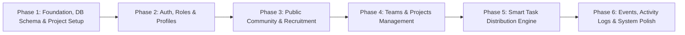

# Roadmap: MECHANEXUS Implementation

## Phase Overview

---

### Phase 1: Foundation, Relational Database Schema & Project Scaffolding
- **Goal**: Establish the repository, modern Vite+React+Tailwind CSS frontend architecture, complete PostgreSQL database schema with RLS policies, Supabase client initialization, and seamless mock data fallback for immediate testing.
- **Deliverables**:
  - Vite React + Tailwind CSS project with lucide-react, react-router-dom, clsx, tailwind-merge.
  - Comprehensive SQL migration file (`supabase/migrations/20261111000000_init_mechanexus.sql`) covering all 11 core tables + triggers + RLS.
  - Supabase client integration with environmental configuration (`.env.example`).
  - Resilient mock storage and auth adapter so all features operate out-of-the-box even before remote Supabase credentials are bound.

### Phase 2: Authentication, Role-Based Access & User Profiles
- **Goal**: Implement secure authentication, profile management, role verification, and route guards.
- **Deliverables**:
  - Login, Registration, and Password Reset screens with validation.
  - Multi-role support (`club_admin`, `coordinator`, `team_leader`, `student`).
  - Protected route wrappers ensuring strict role-based navigation.
  - User profile management (USN, department, semester, skills, bio, avatar upload, public directory visibility toggle).
  - Quick-switch demo persona toggle for effortless testing across all 4 roles.

### Phase 3: Public Community Feed & "Join MECHANEXUS" Recruitment
- **Goal**: Build the public-facing club portal and membership application lifecycle.
- **Deliverables**:
  - Public Community Feed (announcements, project highlights, achievements, image carousel/previews, pinned posts).
  - Admin post creator/manager with rich text and media upload.
  - "Join MECHANEXUS" interactive application form with input validation (USN, branch, technical skills).
  - Admin Membership Application Review Dashboard (Pending, Approved, Rejected with action feedback).
  - Public Club Member Directory with search, domain filtering, and privacy toggles.

### Phase 4: Team & Project Management System
- **Goal**: Implement team collaboration and structured project tracking.
- **Deliverables**:
  - Team creation with unique 6-character team codes.
  - Student join-by-code workflow and member management.
  - Rich project dashboard: Problem statement, proposed solution, category, status, budget vs actual cost, Bill of Materials (BOM) components manager.
  - Project file and documentation uploads.
  - Immutable project audit history logging each edit with author and diff timestamp.

### Phase 5: Smart Task Distribution Engine (OCR & Fair Workload Balancer)
- **Goal**: Deliver the flagship smart task distribution feature with automated parsing and fair allocation.
- **Deliverables**:
  - Task creation wizard with deadline, instructions, and participating student selection.
  - Multi-format ingestion: Image (PNG/JPG), PDF, and Excel (XLSX/CSV) upload.
  - OCR extraction engine (Tesseract.js OCR + SheetJS/PDF parsing) with automatic column detection (Name, Phone, Email, Role/Task, Notes).
  - Interactive record verification grid (add, edit, delete rows before distribution).
  - Workload-aware fair distribution algorithm (equal distribution + fair remainder balancing based on existing active tasks).
  - Student individual task portal: view assigned records, update progress across 5 statuses (`Not Started`, `In Progress`, `Completed`, `Unable to Contact`, `Needs Assistance`).
  - Coordinator task command center: real-time progress bars, student assignment view, and manual reassignment controls.

### Phase 6: Events, Workshops, Global Activity Auditing & Final Verification
- **Goal**: Complete event planning, student duty delegation, real-time activity auditing, responsive UI polish, and end-to-end verification.
- **Deliverables**:
  - Events & Workshops module: schedule, banner, description, student duty checklist (logistics, stage, technical, etc.).
  - Global Activity Log stream capturing all system actions with user attribution, timestamps, and filters.
  - Responsive design verification across mobile, tablet, and desktop viewports.
  - Production build verification (`npm run build`) with zero TypeScript/bundling errors.
